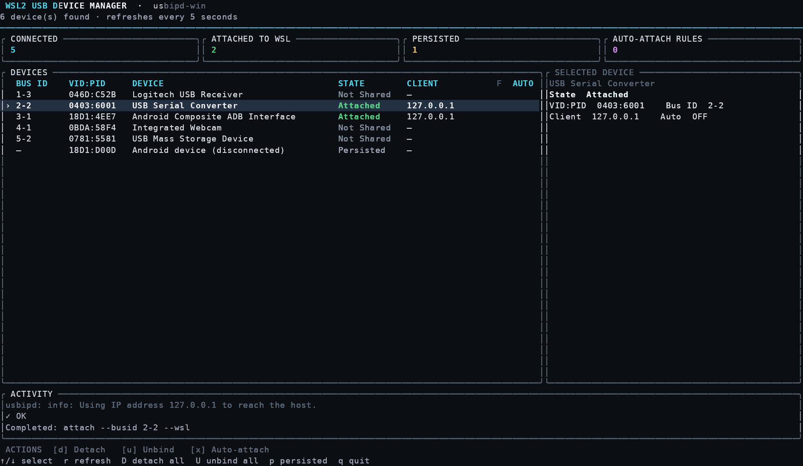

# WSL2 USB TUI

A terminal interface for sharing, attaching, and managing USB devices in WSL2
with [usbipd-win](https://github.com/dorssel/usbipd-win).



## Features

- View connected and persisted USB devices in one table
- See bus IDs, hardware IDs, device state, and attached clients
- Bind, attach, detach, and unbind individual devices
- Detach or unbind all devices at once
- Automatically attach selected bus IDs when they appear
- Refresh device state automatically
- Use keyboard shortcuts
- Handle administrator-only operations through a Windows UAC prompt

## Requirements

- Windows with [WSL2](https://learn.microsoft.com/windows/wsl/install)
- A Linux distribution running under WSL2
- [usbipd-win](https://github.com/dorssel/usbipd-win) installed on Windows
- Docker available from WSL

Install `usbipd-win` from a Windows Command Prompt:

```cmd
winget install usbipd
```

Keep WSL and its kernel up to date:

```cmd
wsl --update
```

## Installation

Build the application and embedded Windows UAC helper inside Docker:

```bash
git clone https://github.com/gabrieldurante/usbipd-tui.git
cd usbipd-tui
./build-docker.sh
```

The executable is written to `target/docker/usbipd-tui`. To install it in your
WSL user's local bin directory:

```bash
mkdir -p ~/.local/bin
install -m 755 target/docker/usbipd-tui ~/.local/bin/usbipd-tui
```

The Windows UAC helper is compiled and embedded automatically. On the first
`bind` or `unbind` operation, the app extracts it to a temporary Windows
directory, requests elevation through the standard UAC prompt, and removes the
temporary executable when the operation finishes. No separate Windows build or
helper installation is needed.

## Usage

Start the application from WSL:

```bash
usbipd-tui
```

Select a device with the arrow keys, then use a keyboard shortcut:

| Key | Action |
| --- | --- |
| `r` | Refresh devices |
| `b` | Bind the selected device |
| `a` | Attach the selected device to WSL2 |
| `d` | Detach the selected device |
| `u` | Unbind the selected device |
| `D` | Detach all devices |
| `U` | Unbind all devices |
| `x` | Toggle automatic attachment for the selected bus ID |
| `p` | Show or hide persisted devices |
| `q` | Quit |

Binding and unbinding require administrator privileges. The sidecar opens a
Windows UAC prompt when either action needs elevation; attaching and detaching
continue to run without elevation.

## Automatic attachment

Press `x` on a connected device to enable automatic attachment for its current
bus ID. The application binds the device if necessary and attaches it to WSL2
whenever it detects that bus ID.

Auto-attach selections are stored at:

```text
~/.config/wsl2_usb/auto_attach_busids.json
```

Set `XDG_CONFIG_HOME` to use a different configuration directory. Because this
feature tracks bus IDs, a device may need to be selected again if Windows
assigns it a different bus ID after it is moved to another USB port.

## Troubleshooting

- Make sure the USB device is connected to Windows and visible to `usbipd`.
- Run `usbipd list` in a Windows terminal to verify the Windows-side installation.
- Keep a WSL terminal open while attaching a device.
- Run `lsusb` in WSL to confirm that an attached device is available to Linux.
- If a device is attached but inaccessible to your user, configure an
  appropriate Linux `udev` rule for it.

For platform-specific help, see Microsoft's
[Connect USB devices under WSL](https://learn.microsoft.com/windows/wsl/connect-usb)
guide.

See [CHANGELOG.md](CHANGELOG.md) for release history.

## License

This project is licensed under the [GNU General Public License v3.0](LICENSE).
